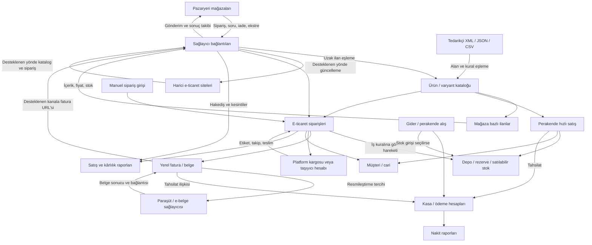

# Supsem incelemesi ve ürün kararları

Tarih: 22 Ekim 2026

## Kısa sonuç

- Tanıdık ana yapı: **ürün → varyant → mağaza ilanı**; sipariş, stok, fatura ve tahsilat bunun etrafında birleşiyor.
- Perakende hızlı/müşterisiz satış; e-ticaret müşteri/adres/sipariş/kargo akışı. Ortak depo, müşteri ve finans ekranlarına bağlanıyorlar.
- E-ticaret siparişinde de **“Resmîleşmesin”** tercihi var. Çalışma alanı ile belgenin resmileşmesi ayrı kararlar.
- Son kapsam kararı: **WooCommerce, Shopify, OpenCart ve diğer harici site bağlantıları ilk etapta yok.** Müşteri Yorumları ve Müşteri Mesajları da mevcut halleriyle Supsem'in site oluşturma modülüne bağlı.
- Sağlayıcıların kabiliyetleri farklı: WooCommerce yön seçimi, Shopify konum/kanal, OpenCart köprü eklentisi, Amazon mevcut ASIN'e teklif.
- İlk tasarım önerisi: tanıdık menü ve iş adımları, ortak HeroUI bileşenleri, cam etkili sınırlı gezinme yüzeyleri ve net veri tabloları.

Bu belge çalışma notudur. Sohbette kısa özetler verilir; ayrıntılar burada tutulur.
Canlı paneldeki gözlemler, Supsem'in kendi açıklamaları ve yeni ürün önerileri birbirinden ayrılır.
Bağlantı anahtarları, müşteri kişisel bilgileri ve hesaba ait kayıt kimlikleri bu belgeye alınmaz.

İnceleme bütün sayfa/modal durumlarını kapsayan tam bir görsel kabul değildir. Kullanıcının son geri bildirimiyle doğrulanan kapsam ve açık arayüz farkları: [Supsem arayüz farkları](supsem-arayuz-farklari.md).

## 1. Kullanıcının belirlediği yön

- İlk müşterilerin önemli bölümü Supsem kullanıyor. Alışılmış ürün, stok, sipariş ve bağlantı mantığı önemli.
- Önceki Pazarhub sürümünde alternatif iş akışlarına ve entegrasyon modeline alışmak zor geldi.
- Kullanıcı, ilişkileri korumayı onayladı; bilgi mimarisi ve çalışma düzeninde de Supsem'den büyük ölçüde uzaklaşılmamasını istedi.
- Amaç Supsem'i kopyalamak değil; tanıdık iş mantığı üzerinde tutarlı ve daha iyi bir deneyim geliştirmek.
- UI temeli HeroUI olacak. Bileşenlerin hem görünüşü hem davranışı uygulama genelinde tutarlı olmalı.
- Tasarım hedefi premium, sakin, Apple esintili. Liquid glass ve animasyonlar değerlendirilebilir.
- Kullanıcı React + Vite seçimini ve Motion/Framer Motion kullanımını onayladı; geliştirme başladı. HeroUI v3 ortak bileşen temeli.
- İlk kapsam dışında: fiyat robotu; Supsem'in site oluşturma/yönetme modülü; dropshipping; pazarlama; insan kaynakları; yardımcı araçlar.
- Sosyal medya yönetimi ve bazı diğer modüller daha sonra değerlendirilebilir.
- WooCommerce, Shopify, OpenCart dahil harici e-ticaret sitesi bağlantıları ilk sürüm kapsamından çıkarıldı.
- Diğer menülerin tamamı otomatik olarak ilk sürüme dahil sayılmaz.
- 23 Ekim kapsam sınırı: önce ana kapsam tamamlanacak. Supsem'de doğrulanmayan yeni bir işlev gerekli görünürse uygulanmadan önce kullanıcıya anlatılıp karara bağlanacak. Son sipariş karşılaştırması: [doğrulama kaydı](supsem-siparis-dogrulama.md).
- Kullanıcı gözlemi: müşteriler, anında fatura düzenlemedikleri bazı işleri perakende tarafında takip ediyor.

## 2. İncelemenin niteliği

Canlı, oturum açılmış panelde navigasyon, mevcut kayıtlar, boş oluşturma formları, ayar açıklamaları ve sekmeler incelendi. Ürün, sipariş, stok, fiyat, fatura veya bağlantı kaydı oluşturma/değiştirme işlemi çalıştırılmadı. Senkronizasyon, test bağlantısı, ürün gönderimi ve geçmiş veri içe aktarımı başlatılmadı.

Panelin gösterdiği periyotlar ve kabiliyetler, gerçek arka plan çalışmasının bağımsız performans ölçümü değildir. Harici mağaza/Paraşüt/kargo bağlantılarının bir kısmı bu hesapta kurulmamış olduğundan bu yollar kurulum formu ve resmi kullanım rehberi üzerinden değerlendirildi.

Tarayıcı ekran görüntüsü aracı görünür pencere hatası verdi. İşlevsel inceleme DOM, erişilebilirlik ağacı ve görünen metinlerle yürütüldü; piksel düzeyinde görsel denetim yapılmış sayılmaz.

## 3. E-ticaret ve perakende ilişkisi

### Canlı panelde gözlenenler

- Üst çubukta E-Ticaret / Perakende çalışma alanı seçicisi var.
- Perakende ana ekranı `/dashboard?mode=retail` adresinde açılıyor.
- Seçim esas olarak ana ekranı ve çalışma bağlamını değiştiriyor; incelenen oturumda ortak yan menü korunuyor.
- Perakende kısayolları ortak müşteri, kasa, cari, stok ve gider ekranlarına bağlanıyor.
- Perakende satış geçmişi ayrı bir liste: `/dashboard/retail/sales`. Açıklaması yalnız bu panelde girilen satışları kapsadığını söylüyor.
- Bu liste tarayıcıda `GET /api/v1/retail/sales` çağrısıyla okunuyor.
- İncelenen hesapta perakende satış listesi boştu; tamamlanmış bir satışın bütün muhasebe etkisi canlı kayıt üzerinden doğrulanamadı.

### Perakende yolları

| İş | Yol | Bağlandığı ortak yapı |
|---|---|---|
| Yeni satış | `/dashboard/retail/sale` | Ürün/varyant, depo, müşteri, ödeme hesabı |
| İade | `/dashboard/retail/return` | Eski satış, iade edilebilir miktar, stok ve geri ödeme tercihi |
| Eski satışlar | `/dashboard/retail/sales` | Fiş, müşteri, depo, tarih ve durum filtreleri |
| Yeni alış | `/dashboard/retail/purchase` | Gider belgesi, isteğe bağlı depo girişi |
| Cari hareket | `/dashboard/retail/customer-entry` | Ortak müşteri borç/alacak hesabı |
| Kasa giriş/çıkış | `/dashboard/retail/cash?type=in` ve `type=out` | Ortak kasa |
| Müşteri kaydı | `/dashboard/customers/new` | Ortak müşteri kartı |
| Stok durumu | `/dashboard/inventory/levels` | Ortak depo stokları |
| Kasa, cari, gider | `/dashboard/accounting/...` | E-ticaret menüsündeki aynı ekranlar |

### Satış formu

- Müşteri isteğe bağlı; veresiye için müşteri gerekiyor.
- Şube/depo seçimi zorunlu.
- Barkod okutma veya ürün/SKU/barkod aramasıyla satır ekleniyor. Aynı barkod miktarı artırıyor.
- Satırlar: miktar, KDV dahil birim fiyat, indirim, KDV ve ara toplam.
- Nakit, kart, havale; bölünmüş tahsilat; veresiye; alınan nakit ve para üstü alanları var.
- Müşteri kartındaki iskonto toplamda kullanılabiliyor.
- Satış kaydı, fiş görünümü ve resmileştirilmiş e-fatura ayrı kavramlar.
- Arayüz açıklamasına göre kart/havale seçimi bir tahsilat kaydıdır; banka/POS işlemini otomatik çalıştırmaz.

### Alış ve iade

- Yeni alış, ürün alışını gider olarak kaydediyor; depoya stok eklemek ayrıca seçiliyor.
- Tedarikçi, belge numarası, ödeme hesabı ve ödeme sonra yapılacak seçeneği var.
- Cari borç/alacak fişi ekranı açıkça kasa hareketi oluşturmadığını belirtiyor.
- Rehbere göre iade, kısmi/tam miktar ve yeniden stoka alma tercihiyle yapılıyor. Hasarlı üründe stok dönüşü ayrıca değerlendiriliyor.

**Yeni ürün için çıkarım:** Ortak katalog/depo/cari temelini koruyan iki anlaşılır çalışma alanı iyi bir aday. Satış kanalı, satış kaydı, tahsilat ve belge durumu ayrı alanlar olmalı; kullanıcıya iki ayrı stok sistemi kurdurulmamalı.

## 4. Ürün, varyant ve kanal ilanı modeli

### Ürün listesi

- `/dashboard/products`: ad/SKU/barkod araması, filtre, stoğu bitenler, sütun seçimi, Excel/CSV.
- Ürün, kategori, marka, varyant sayısı, KDV dahil fiyat, stok, bağlı pazaryerleri ve durum birlikte gösteriliyor.
- Yeni ürün, linkten ürün alma ve paket oluşturma girişleri ayrı.
- Satırdaki kanal simgesi doğrudan ürünün ilgili mağaza entegrasyon sekmesine gidiyor.

### Ürün kartı sekmeleri

Ürün Bilgileri, Stoklar, Fiyatlar, Detay Açıklama, Barkodlar, Resimler, Varyantlar, Teknik Özellikler, Entegrasyonlar.

- Temel kart: ürün/fatura adı, kategori, marka, tedarikçi, model kodu, birim, menşe, GTIP, vergi, para birimi ve desi.
- Varyantların SKU ve barkodları ayrı; ana kod öneki toplu değiştirilebiliyor.
- Vergi ve para birimi ana ürün düzeyinde ortak; alış/satış/liste fiyatları varyant düzeyinde.
- Stok sekmesi depoya ve varyanta göre stok/rezerve miktarı gösteriyor.
- Stok düzenlemesi açıklamasında farkın hareket defterine “düzeltme” olarak yazıldığı belirtiliyor.
- Varyant listesinde stok, fiyat, barkod, raf ve durum birlikte var.
- Renge bağlı görseller, kapak seçimi ve görsel alt metni bulunuyor.
- AI alanları ürün metni hazırlama ve referans görselden listeleme görseli üretme üzerine kurulu.

### Kanal ilanı ayrı bir katman

Canlı üründe Trendyol mağazasına ait iki varyant ilanı incelendi:

- Mağaza başına ilan durumu, uzak kayıt kimliği, model kodu, fiyat ve varyant ayarları ayrı tutuluyor.
- Ortak ürün kartının üstüne mağaza/ilan özel başlık, açıklama, kategori özellikleri, görseller, kargo, termin ve fiyat yazılabiliyor.
- Platformda kayıtlı ilanda bazı alanlar kilitli: barkod, kategori, marka ve varyant ekseni.
- Varyantların aynı model kodunda gruplanması veya farklı model kodlarıyla gönderilmesi seçilebiliyor.
- Elle fiyat / marjdan hariç tutma ile hesaplanan marj fiyatının ilişkisi gösteriliyor.
- İlan düzenleyicisi yeni sayfa/modal yerine ürün entegrasyon bölümünün içine açılabiliyor.
- “Uygula” yerel ilan ayarını kaydediyor; pazaryerine gönderim ayrı işlem.

### Varsayılanların miras alınması

Panel açıklamasına göre:

1. Bağlantı varsayılanları ve kategori/marka/renk eşlemeleri başlangıç değerlerini sağlıyor.
2. Kaydedilen bazı ürün değerleri ürüne sabitleniyor; eşleme değişince topluca yeniden yazılmıyor.
3. Boş özellikler sonradan eklenen eşleme değerini alabiliyor.
4. Varyantın rengi/bedeni ve ürün ölçülerinden türetilen bazı alanlar kaynağını izlemeye devam ediyor.
5. İlan düzeyinde değiştirilen alan o ilana özel hale geliyor.

**Yeni ürün için çıkarım:** Alanın “nereden geldiği” ve “hangi değişiklikten etkileneceği” görünür olmalı. Tanıdık ürün → varyant → mağaza ilanı ilişkisini koruyup bu miras/istisna mantığını daha anlaşılır sunabiliriz.

## 5. Platform Listelemeleri ve ürün alma

Yol: `/dashboard/listings`.

- Önce mağaza seçiliyor; İlanlarım ve Ürün Eşlemesi görünümleri var.
- İlan sekmeleri: gönderilen, gönderilmeyi bekleyen, onay bekleyen, reddedilen, platformda bulunamayan, kilitli, arşivlenen, eşlemesi olmayan.
- Kategori, marka, stok ve satış durumu filtreleri bulunuyor.
- Toplu işlemler sekmeye/duruma göre değişiyor. Gönderim, güncelleme, durum sorgulama, satışa açma/kapama ve bağlantı işlemleri ayrışıyor.
- Ürün Eşlemesi ayrı bir “uzak ilan havuzu” mantığı taşıyor.
- Açıklamaya göre pazaryerinden çekilen ilan, barkod/SKU/ad üzerinden yerel ürünle karşılaştırılıyor; öneri onaylanabiliyor, varyant elle seçilebiliyor veya eşleşmeyen kayıt ürün olarak alınabiliyor.
- Görünümler: Bağlanmamış, Öneri var, Eşleşme yok, Bağlı.
- İncelenen uzak ilan havuzu henüz çekilmemişti; önerilerin doğruluk oranı ölçülmedi.
- Gözlenen okuma uçları: `GET /api/v1/marketplaces/trendyol/remote` ve `/remote/counts`.

## 6. Pazaryeri bağlantıları

Yol: `/dashboard/integrations/marketplaces/{provider}`.

| Sağlayıcı | Formda istenen temel bağlantı bilgisi | Dikkat çeken özel davranış |
|---|---|---|
| Trendyol | Satıcı ID, API Key, API Secret | Barkodla sipariş eşleme, kategori/marka/renk, termin ve anlaşmalı kargo |
| Hepsiburada | Merchant ID, entegratör servis anahtarı | Entegratör yetkilendirmesi; kargo modeli seçimi |
| n11 | API Key, API Secret | Teslimat şablonu bağlantı testinden sonra alınabiliyor |
| Çiçeksepeti | Satıcı ID, API Key | Kargo/servis aracı teslimat tipi |
| Pazarama | Client ID / API Key, Client Secret | Formda anahtarın süreli olduğu belirtiliyor |
| PttAVM | Mağaza ID, API kullanıcısı, parola | Kargo deposu; sipariş tutarına bağlı kargo bedeli ayarı |
| ToptanTR | API kullanıcısı, parola | Açıklamaya göre diğer işlemler için token üretiliyor |
| Amazon Türkiye | Seller ID, LWA Client ID/Secret, Refresh Token | Mevcut ASIN'e SKU ile teklif; başlık/açıklama/görseller Amazon kataloğundan |
| Cimri | Site ürünlerinden oluşturulan XML yayını | Satıcı siparişi entegrasyonu yerine karşılaştırma ve siteye yönlendirme |

### Ortak bağlantı modeli

- Bağlantı adı; aynı sağlayıcıda birden fazla mağaza; varsayılan/aktif durumları.
- Mağazanın kullandığı stok deposu/depolar.
- Uygun bağlantı varsa mağaza bazlı fatura sağlayıcısı seçimi (Paraşüt rehberinde açıklanıyor).
- Sağlayıcıya göre kargo ve termin varsayılanları.
- Sipariş, durum, fatura, soru, iade, hakediş, ilan izleme ve fiyat/stok senkronu ayrı tercihler.

### Panelde açıklanan periyotlar

- Siparişler: 5 dakika.
- Müşteri soruları: 5 dakika; desteklenen sağlayıcılarla sınırlı.
- İade talepleri: saatte bir; desteklenen sağlayıcılarla sınırlı.
- Hakediş: günde bir, son 45 gün; incelenen formlarda Trendyol, Hepsiburada ve n11'de bulunuyor.
- İlan değişikliği izleme: 30 dakika; açıkken uzak fiyat ve satış/kilit/ret durumunu yerel kayda alıyor.
- Otomatik fiyat/stok: 10 dakika; açıklamaya göre yalnız değişen ilanlar gönderiliyor.
- Ürün entegrasyon ekranında onay durumunun 3 dakikada bir kontrol edildiği yazıyor.

Bu süreler arayüz beyanıdır; gerçek iş kuyruğu, gecikme dağılımı ve hata oranı ölçülmedi.

### Amazon farkı

Form ve sayfa açıkça daha dar bir kapsam gösteriyor: Türkiye'deki satıcı gönderimli siparişler, SKU eşleme, mevcut ASIN'e teklif, fiyat/stok ve takip numarasıyla kargoya verildi bildirimi. Onay/iptal/teslim bildirimi gönderilmediği belirtiliyor. Diğer sağlayıcıların tüm anahtarları bu forma konmamış.

**Yeni ürün için çıkarım:** Tek tip bağlantı deneyimi + sağlayıcıya özgü gerçek kabiliyetler. Arayüz tutarlılığı, bütün sağlayıcıların aynı işi yapıyormuş gibi sunulması anlamına gelmemeli.

## 7. Harici e-ticaret sitesi bağlantıları

Bu bölüm kullanıcı tarafından ilk kapsamdan çıkarılan “Site Yönetimi” ile aynı şey değildir.
Son kapsam kararı: Bu harici bağlantılar da ilk etapta geliştirilmeyecek; aşağıdaki bilgiler araştırma bulgularıdır.

### WooCommerce

- Yol: `/dashboard/integrations/site-platforms/woocommerce`.
- HTTPS mağaza adresi + REST API Consumer Key/Secret.
- Ürün bilgisi yönü seçiliyor: çift yönlü, SUPSEM → WooCommerce, WooCommerce → SUPSEM.
- Gelen ürünleri otomatik alma ve yerel ürünleri otomatik gönderme ayrı anahtarlar.
- İki tarafta aynı ürün değişmişse SUPSEM sürümünün korunduğu yazıyor.
- Otomatik katalog taraması açıklaması: 5 dakikada en fazla 50 ürün; büyük katalog sonraki turlarda devam ediyor.
- Yeni/güncellenen sipariş ve dış ödeme/durum değişiklikleri için 5 dakika belirtiliyor.
- Geçmiş siparişler ayrı tarih aralığıyla alınabiliyor; eşleşmeyen satır onaydan önce eşleniyor.
- Kargo, teslim ve uygun iptal bildirimi dış mağazaya gidebiliyor. Para iadesi ayrı süreç.
- Fiyat/stok senkronunun ürün içeriği yönünden ayrı ayar olduğu açıkça yazıyor.

### Shopify

- Yol: `/dashboard/integrations/site-platforms/shopify`.
- `*.myshopify.com` mağaza adresi + Admin API erişim anahtarı.
- Bağlantı kaydedildikten sonra stok konumu ve satış kanalı seçenekleri alınıyor/seçiliyor.
- Yerel kategori → Shopify koleksiyonu eşlemesi ürün gönderimine temel oluyor.
- Yeni sipariş çekimi, kargo/teslim bildirimi, fiyat/stok ve eşlenmiş ürün gönderimi ayrı anahtarlar.
- Ödeme, iptal ve iadenin mağazada yönetildiği formda belirtiliyor.
- Bu hesapta aktif Shopify bağlantısı olmadığı için gerçek mağazaya aktarım doğrulanmadı.

### OpenCart

- Yol: `/dashboard/integrations/site-platforms/opencart`.
- OpenCart 3/4 için SUPSEM Bridge eklentisi gerekiyor.
- HTTPS adres, sürüm, mağaza numarası ve köprü bağlantı anahtarı.
- Vergi sınıfı ve kategori eşlemesi gerekiyor.
- Her varyant ayrı OpenCart ürünü olarak aktarılıyor; yerel option kombinasyonları desteklenmiyor.
- Kurulum belgesi; UUID/SKU sahipliği, eşzamanlı stok yazımı çatışmaları, sipariş sonrası stok uzlaştırma ve yinelenen işlemi önleme yaklaşımını açıklıyor.
- Belgeye göre kargo/teslim bildirimi var; ödeme, iptal ve iade yazımı yok.
- Aynı belge gerçek mağaza uyumluluğunun ayrıca kabul edilmesi gerektiğini söylüyor. Bu çalışma kapsamında gerçek OpenCart kurulumu denenmedi.

**Yeni ürün için çıkarım:** Bağlantıda yalnız anahtar sormak yeterli değil. Stok kaynağı, veri yönü, eşleme, geçmiş veri alma, çakışma önceliği ve kanalın desteklemediği işlemler anlaşılır olmalı.

## 8. Fatura sağlayıcısı ve kargo bağlantıları

### Paraşüt

- `/dashboard/integrations/accounting/parasut`.
- Client ID/Secret, hesap e-postası/parolası, Company ID.
- Çoklu bağlantı ve varsayılan bağlantı.
- Otomatik fatura oluşturma tetikleyicisi ortak E-Ticaret Ayarları'nda; resmileştirme davranışı bağlantıda.
- Taslak olarak bırakma veya otomatik resmileştirme; dakika cinsinden gecikme.
- Rehberde varsayılan gecikme 60 dakika. İhracatta farklı davranış belirtiliyor.
- İrsaliye, ihracat muafiyet kodu, tahsilatı Paraşüt hesabına yazma, internet satışı bilgileri seçenekleri var.
- Rehberin akışı: yerel fatura → Paraşüt taslağı/resmileştirme → fatura URL'si → sipariş → desteklenen pazaryeri.
- İncelenen hesapta Paraşüt bağlantısı kurulmamış; aktarım başarısı denenmedi.

### Kargo

- Yurtiçi, PTT ve DHL eCommerce bağlantı sayfaları canlı olarak incelendi.
- Yurtiçi/PTT web servis hesabı; DHL eCommerce müşteri numarası/API parolası istiyor.
- Sayfa açıklamalarında onay üzerine veya elle gönderi oluşturma, kabul edilince kargoya verildi, teslimde teslim edildi durum akışı bulunuyor.
- Pazaryeri anlaşmalı kargo modeli ayrıca mevcut: kargo kodu, etiket ve takip pazaryerinden geliyor.
- Fiziksel taşıyıcı bağlantısıyla pazaryeri anlaşmalı kargoyu aynı iş gibi ele almamak gerekiyor.

## 9. XML bağlantıları

- `/dashboard/integrations/xml/import`: dosya adresi, alan eşleme, fiyat/stok kuralları ve zamanlı güncelleme.
- Yeni besleme açıklaması, kullanıcı etkinleştirene kadar kataloğa yazılmadığını belirtiyor.
- `/dashboard/integrations/xml/export`: bayi/entegratörlerin okuyabileceği, anahtarlı ürün yayını; kapsam, tazeleme, fiyat ve KDV tercihi.
- İncelenen varsayılan yayın kapalıydı; adresi kopyalanmadı veya yayımlanmadı.
- Tedarikçi katalog aktarımı, dropshipping sipariş/tedarikçi operasyonundan ayrı bir ürün kararıdır.

Yeni besleme formu XML yanında JSON ve CSV adresini de kabul ettiğini belirtiyor. İlk adım ad ve HTTPS adresi; dosya tarama, kimlik ve alan eşleme sonraki aşama. Besleme kaydı oluşturulmadığı için sonraki sihirbaz canlı olarak yürütülmedi.

## 10. Ortak e-ticaret ayarları

Yol: `/dashboard/ecommerce-settings`.

Sekmeler: Genel, Ürün ve Stok, Döviz Kurları, Siparişler, Yazdırma Şablonları.

### Ürün, fiyat ve depo

- Yeni ürünün vergi, para birimi, marka, menşe, SKU hanesi, barkod öneki ve desi varsayılanları.
- Eksi stoğa izin verme seçeneği var; açıklama, pazaryerine gönderilen miktarın en az sıfır olduğunu belirtiyor.
- Ürün fiyatının KDV dahil/hariç yorumlanması ortak bir ayar.
- Düşük/kritik stok eşikleri ve renkleri tanımlanıyor.
- E-ticarette kullanılacak depolar seçilebiliyor veya tüm depolar kullanılabiliyor; seçilenlerin stok toplamı esas alınıyor.
- Sağlayıcı bağlantısında ayrıca mağaza deposu seçimi var. Boş/global/mağaza özel seçimlerinin bütün öncelik durumları bu oturumda test edilmedi.
- Kur ekranı TCMB verisi, kur türü ve verinin tarihini gösteriyor; arayüzde saatlik güncelleme, tatilde son bilinen kur açıklaması var.

### Sipariş davranışı

- Liste açılış tarih aralığı ve varsayılan termin.
- Yeni pazaryeri siparişinin bekliyor veya otomatik onaylandı başlaması.
- Açıklamaya göre otomatik onay stok düşümünü, fatura kuralını ve desteklenen platform bildirimini tetikliyor.
- Otomatik kargo gönderisi; site siparişi ve uygun “kendi kargom” bağlantı modelleriyle sınırlı. Pazaryerinin verdiği kargo ile aynı işlem değil.
- Faturanın hangi aşamada oluşturulacağı ortak ayardan belirleniyor.
- İhracat için onay aşamasında faturalama tercihi ayrıca var.
- İptalde stok dönüşü otomatik veya elle seçilebiliyor.

### Yazdırma

Kargo etiketi, sipariş detayı, ürün barkodu, fatura ve hesap ekstresi şablonları ayrı. Yardımcı araçlar üst menüsünü çıkarmak, temel etiket/yazdırma işlevlerini çıkarmayı gerektirmiyor.

## 11. Sipariş akışı ve belge durumu

### Liste ve detay

- `/dashboard/orders`: tarih aralığı, arama, filtre, sütun seçimi, durum sayımları, hazırlık ve fatura sütunu.
- Ana durumlar: bekliyor, onaylandı, kargoya verildi, teslim edildi, iade edildi, iptal edildi.
- Liste doğrudan sipariş, müşteri, fatura ve yazdırma yollarına bağlanıyor.
- Bir manuel ve bir pazaryeri siparişinin detay ekranı incelendi.
- Detay: ürün/kalem hazırlık işaretleri, sipariş geçmişi, fatura, notlar, ekler, müşteri, tahsilat, ödeme/kargo ve stok bilgileri.
- Pazaryeri siparişinde platform kargo etiketi alma; manuel siparişte genel yazdırma ve yerel işlemler görülüyor.
- Durum değiştirme, tahsil edildi işaretleme, iade oluşturma gibi işlem düğmeleri çalıştırılmadı.

### Yeni manuel sipariş ile perakende farkı

`/dashboard/orders/new` formunda müşteri, alıcı adı ve açık adres zorunlu. Perakende satışında müşteri/adres zorunluluğu yok; odak barkod ve tahsilat.

- Manuel siparişte kaynak, kaynak sipariş numarası, para birimi, ödeme yöntemi ve tahsilat durumu var.
- Ürün katalogdan seçilirse onay aşamasında stok düşeceği açıklanıyor.
- Serbest metin kalemi ürün kaydı oluşturmuyor ve stok düşürmüyor.
- Kargo bedeli, müşteri notu ve iç not ayrı.
- Kaynağın elle “Trendyol” seçilebilmesi, platformda sipariş oluşturulduğu anlamına gelmez; dış platformda sipariş oluşturma bu incelemede görülmedi.

### Üç ayrı kavram

1. **İş akışı:** sipariş/satış hangi durumda?
2. **Belge:** iç kayıt oluşturuldu mu, dış e-fatura sağlayıcısında resmileşti mi?
3. **Tahsilat:** ödeme kaydedildi mi, hangi hesaba işlendi?

Siparişin fatura tercihlerinde:

- **Ayara göre:** ortak otomatik fatura aşamasını izler.
- **Hemen:** oluşturma sonrası fatura/resmileştirme sürecini başlatır.
- **Resmîleşmesin:** yerel fatura kaydı oluşabilir; otomatik resmileştirme yapılmaz.

**Yeni ürün için çıkarım:** Kullanıcının “perakende = belge düzenlemeyeceğim iş” alışkanlığını anlamak gerekir; fakat veri modelinde kanal, iş akışı, belge ve tahsilat ayrı tutulmalı. Tanıdık hızlı satış ekranı korunabilir.

## 12. Depo, stok hareketi, paket ve toplu işlemler

### Stok

- `/dashboard/inventory/levels`: her satır varyant/SKU; depo bakiyeleri, toplam, rezerve ve satılabilir stok ayrı sütunlar.
- `/dashboard/inventory/movements`: tarih, ürün, depo, tür, miktar, bakiye, sebep, belge ve kullanıcı.
- `/dashboard/inventory/transfers`: açıklamaya göre kaydetmede kaynaktan düşüp hedefe ekleniyor. Tek depolu incelenen hesapta yeni transfer düğmesi pasifti; sebebi ayrıca test edilmedi.
- `/dashboard/inventory/counts`: açık sayımda miktar girişi, tamamlamada farkları düzeltme hareketine dönüştürme açıklaması.
- Toplam, rezerve ve satılabilir miktarın farklı kavramlar olarak sunulması korunmaya değer.

### Paket

`/dashboard/products/new/bundle` üç aşamalı: kategori → içerik → paket bilgileri. İlk araştırma yalnız başlangıç ekranını kapsıyordu. 23 Ekim devam turunda üç adım da kaydetmeden açıldı; bileşen miktarları, bağlı/sabit fiyat ve açıklama/görsel tercihleri doğrulandı. Gerçek Supsem stok işlemi yapılmadı. Uygulanan ortak paket stoku ve sınırlar [paket/stok doğrulamasında](supsem-paket-stok-dogrulama.md).

### Toplu işlemler

`/dashboard/bulk-operations` üç parçalı: ürünleri seç → işlem seç → önizle/uygula.

- Kategori, marka, tedarikçi, arama ve stok/satış filtreleri.
- Fiyat, stok, sınıflandırma, ürün bilgisi, ölçü/kargo, metin ve silme işlemleri.
- Fiyatın hedefi, fiyat türü, yöntem, değer ve yuvarlama ayrı.
- Hiç satır işaretlenmezse filtreye uyan bütün ürünlerin hedefleneceği yazıyor.
- Önizleme yapılmadan uygulama açılmıyor.

Bu “önce değişikliği göster” yaklaşımı Supsem'de zaten var; yeni ürünün özgün özelliği gibi sunulmamalı.

## 13. Eşleme ve marj kuralları

### Tanımlamalar

Yerel kategori, varyant tipi/değeri, renk, depo, tedarikçi, marka ve teknik özellik yönetimleri ayrı yollar altında.

`/dashboard/definitions/mappings` ekranı sağlayıcı seçimiyle çalışıyor:

- **Kategori:** yerel son seviye kategori → platform son seviye kategori; komisyon ve varsayılan özellikler.
- **Marka:** platform araması ve yerel karşılık; bütün marka kataloğunu kullanıcıya bir kerede yükletme yerine arama imkanı.
- **Renk:** sağlayıcı destekliyorsa adı aynen gönderme veya platform değerine eşleme.
- **Varyant değeri:** önce yerel eksenin karşılığı, ardından o eksenin değerleri.
- **Teknik detay:** özellik ve değer eşlemesi; ürünün platform kategorisiyle uyumluysa gönderime katılıyor.

Kategori tablosu ve sekmelerin açıklamaları incelendi. Eşleme kaydı değiştirilmedi; her kategori için zorunlu özellik doldurma işlemi baştan sona denenmedi.

### Marj

`/dashboard/definitions/margins` fiyat robotundan ayrı:

- Mağaza seçilir.
- Kural önceliği: **ürün → desi → fiyat aralığı → marka → kategori → toplu**.
- Kargo, sabit gider, artış/azalış yönü, marj tipi/değeri ve platform komisyonu.
- Kapsamı marjdan hariç tutma; fiyat bandı için sabit fiyat seçebilme.
- “Yüzde — tabana oran” ifadesi fiyat artışının satış kâr marjıyla aynı olmadığını açık ediyor.
- İlk sürümde fiyat robotu çıkarılsa da mağaza bazlı fiyat/marj ihtiyacı ayrıca korunmalı/değerlendirilmeli.

## 14. Müşteri, fatura, gider, kasa ve cari

### Müşteri

- Manuel, Pazaryeri, Website ve Tümü filtreleri.
- Grup, kişisel iskonto, aktif/pasif, bireysel/kurumsal fatura bilgileri ve çoklu adresler.
- Kart açmada ad ve soyad zorunlu; sipariş formunun adres şartı ayrı.
- Form açıklaması: kişisel iskonto diğer indirimleri geçersiz kılabiliyor.
- Perakende, manuel sipariş ve cari hareket ekranları aynı müşteri seçicisi/kartlarına bağlanıyor.

### Fatura

- Liste: ödeme bekleyen, vadesi geçen, ödenen, iptal; belge durumu ile resmileşme ayrı sütunlar.
- Yeni fatura: müşteri, tarihler, para birimi, kategori, etiket, kalem, ödeme durumu ve resmileştirme tercihi.
- Bağımsız faturada katalogdan eklenen ürünün kayıtta stoktan düşeceği belirtiliyor; serbest hizmet/ürün satırı ayrıca var.
- Yeni fatura kalem fiyatı KDV hariç isteniyor. Perakende kalem fiyatı KDV dahil; ürün fiyatları ise genel ayara bağlı.
- Mevcut bir faturada dışarıda kesilen belgenin linkini/numarasını iliştirme ve elle resmileştirildi işareti görülüyor.
- Siparişten doğan fatura ile bağımsız faturanın stok etkisinin yinelenmemesi, yeni sistem için kritik bir iş kuralı.

### Gider

- Hızlı tek tutarlı fiş veya detaylı kalemli belge.
- Tedarikçi, tarih/vade, kategori, etiket, para birimi ve belge eki.
- “Ödendi” tercihi kasa çıkışı yazıyor; bekleyen belge ayrı izleniyor.

### Kasa ve cari

- Kasa; giriş/çıkış/virman, ödeme yöntemi, depo, belge, müşteri ve işlem yapan kişiyle izleniyor.
- Cari hesap; müşteri borcu/alacağı, vade, risk limiti ve son hareket.
- Cari borç/alacak fişi, ödeme/tahsilat ve fatura aynı kavram olarak ele alınmıyor.
- Perakendedeki kısayollar bu ortak ekranlara dönüyor.
- Bu inceleme yazma işlemi çalıştırmadığı için sipariş → fatura → tahsilat zincirindeki tekrar önleme davranışı bağımsız olarak doğrulanmadı.

**Bileşen çıkarımı:** Para alanında para birimi, KDV esası, indirim tipi ve yuvarlama açık olmalı. Aynı görünümlü iki fiyat alanına farklı anlamlar yüklenmesini azaltacak ortak `MoneyField` gerekli.

## 15. Raporların veri kaynakları

Canlı olarak Satış Özeti, Kâr/Zarar, Pazaryeri Hakediş, Nakit Akışı ve Veri Kalitesi incelendi. Diğer raporların menü/yolları haritalandı; her biri ayrıntılı denetlenmedi.

| Rapor | Ekranda açıklanan temel kaynak |
|---|---|
| Satış özeti | Sipariş/kalem, durum, iade, kanal ve satış tarihi |
| Kâr/Zarar | Sipariş maliyeti, komisyon, kargo, dönem platform kesintisi ve işletme gideri |
| Pazaryeri hakediş | Sipariş, tahmini komisyon, gerçekleşmiş ekstre ve ekstre kesinti türleri |
| Nakit akışı | Kasa hareketleri, hesaplar, gider belgeleri ve virman ayrımı |
| Veri kalitesi | Katalog eksikleri, bağlı olmayan sipariş kalemleri, maliyet/komisyon/kargo kapsaması |

### Önemli ayrımlar

- KDV dahil ciro ile KDV hariç kâr tabanı ayrılıyor.
- Siparişe bağlanabilen kargo bedeli ile dönem gideri olarak kalan kesinti ayrılıyor.
- Tahmini komisyon ile ekstredeki gerçekleşmiş komisyonun kaynağı gösteriliyor.
- Stopaj, masraf ve platformun satıcıya yaptığı ödeme farklı kalem türleri olarak açıklanıyor.
- Nakit akışı ekranı pazaryeri kesintileri kasa defterine yazılmadığı için brüt görünebileceğini açıkça söylüyor.
- Veri kalitesi; eksik maliyet, eksik komisyon, ürüne bağlanmamış kalem, mükerrer barkod, katalog eksiği ve kargo giderini listeliyor.
- Güncel veri kalitesi açıklamasında alış maliyetinin satış anında siparişe kopyalandığı, sonradan girilen maliyetin geçmişi kendiliğinden değiştirmediği belirtiliyor.
- Katalogda alış fiyatı dolu olması, eski satışların maliyetinin dolu olduğu anlamına gelmiyor.

### Yeni ürün için değerlendirme

- Ciro, satış katkısı/kârı, faaliyet kârı, tahmini hakediş, gerçekleşen kesinti ve banka tahsilatı için ortak bir metrik sözlüğü gerekli.
- İncelenen aynı dönemli ekranlarda aynı “Net kâr” başlığı altında farklı tutarlar görüldü. Dönem kesintisi/kapsam ayrımıyla ilişkili olabilir; bu tek başına hesap hatası teşhisi değildir. Yeni üründe hesap kapsamı ve kaynak tutarlılığı doğrulanmalı.
- Eksik veriyle hesaplanan tutar, kapsam bilgisiyle birlikte sunulmalı; bilinmeyen maliyet sıfır maliyet gibi anlaşılmamalı.
- Perakende satışının satış/kâr raporlarına nasıl dahil olduğu, boş perakende geçmişi nedeniyle bu oturumda kesinleştirilemedi.

## 16. Müşteri talepleri ve site modülü bağımlılıkları

| Menü | Canlı ekrandaki kapsam | İlk sürüm değerlendirmesi |
|---|---|---|
| Müşteri Soruları | Pazaryeri ürün/sipariş sorusu, hazır cevap, platforma yanıt | İhtiyaca göre çekirdekte |
| İade Yönetimi | Pazaryeri kalem bazlı iade/onay/itiraz; yerel siparişte iade giriş noktası da var | Çekirdek iş akışı adayı |
| Müşteri Yorumları | Supsem ile açılan sitelerdeki ürün yorumları ve yayın/onay | Site oluşturma modülüyle birlikte ertelenebilir |
| Müşteri Mesajları | Supsem sitelerinin iletişim formu; yanıt düğmesi posta istemcisini açıyor | Site oluşturma modülüyle birlikte ertelenebilir |

Yorumlar ve Mesajlar ekranlarında, Supsem sitesi olmadığı için site oluşturma yönlendirmesi görüldü. Bunları çok kanallı pazaryeri mesajlaşması gibi değerlendirmemek gerekiyor.

Soru/iade listeleri bu hesapta boştu. Hazır cevap oluşturma, dışarıya yanıt gönderme ve iade onaylama çalıştırılmadı.

## 17. Kullanıcı ve rol yönetimi

- Kullanıcı listesinde rol, durum, son giriş ve ekleyen kişi bilgileri bulunuyor.
- Açıklama, kullanıcının kendi oluşturduğu hesapları ve onların altındakileri gördüğünü belirtiyor.
- Sistem rolleri değiştirilemiyor; özel rol için şablon olarak kopyalanabiliyor.
- Özel role yalnız kişinin kendisinde bulunan izinleri verebileceği yazıyor.
- Kullanıcı/rol yönetimi, ertelenen insan kaynakları modülünden ayrı bir platform ihtiyacı.
- Yetki sınırları farklı hesaplarla denenmedi; ekran beyanı olarak kaydedildi.

## 18. Kavramsal veri akışı

Ekran ve rehberlerden çıkarılan harita; Supsem'in veritabanı şeması veya kaynak kodu iddiası değildir.

## 19. İlk kapsam için önerilen sadeleştirme

Bu bölüm öneridir; kullanıcının onayladığı kesin kapsam değildir.

### Tanıdık çekirdek

- **Genel:** Dashboard, Siparişler, Müşteriler.
- **Mağaza Yönetimi:** Ürünler, Platform Listelemeleri, Tanımlamalar, Marj Ayarları, Stok, temel toplu işlemler.
- **Perakende çalışma alanı:** Yeni Satış, İade, Eski Satışlar; ortak kasa/cari/stok kısayolları.
- **Müşteri Talepleri:** Soru ve İade Yönetimi.
- **Muhasebe Yönetimi:** Fatura, Gider, Kasa, Cari.
- **Entegrasyonlar:** Seçilecek pazaryerleri, e-fatura ve gerekli kargo bağlantıları. Harici site bağlantıları ilk kapsam dışında.
- **Raporlar:** Öncelikle satış, stok, kârlılık/hakediş ve veri kalitesi; kapsam müşteri ihtiyacıyla daraltılabilir.
- **Yönetim:** Kullanıcı, rol, temel ayarlar ve destek.

### Ek erteleme adayları

Kullanıcının ilk çıkardıklarına ek olarak: siteye bağlı Yorumlar/Mesajlar/Cimri yayını; kişisel finans; demirbaş/zimmet; çek/senet; bütçe; gelişmiş müşteri segmentasyonu. Bunlar için talep kanıtı toplanabilir.

### Birbirine karıştırılmaması gerekenler

- Fiyat robotu ≠ temel mağaza fiyatı/marj kuralı.
- Site oluşturma ≠ mevcut WooCommerce/Shopify/OpenCart mağazasını bağlama.
- Dropshipping operasyonu ≠ tedarikçi katalog dosyasını içe alma.
- İnsan kaynakları ≠ uygulama kullanıcıları ve izinleri.
- Yardımcı araç menüsü ≠ sipariş/kargo/barkod yazdırma ihtiyacı.

## 20. Gözlemden çıkan iyileştirme fırsatları

| Gözlem | Tanıdık mantığı koruyan geliştirme |
|---|---|
| Bağlantı kur, tekrar düzenle, seçenek getir, eşle, üründen gönder adımları farklı ekranlarda | Aynı adımları bir kurulum ilerleme görünümünde takip ettirmek; ilgili ekrana doğrudan geçiş |
| Varsayılanlar genel ayar, bağlantı, eşleme, ürün ve ilan düzeyinde | Her alanın kaynağını ve kapsamını gösteren ortak “miras/özel değer” deseni |
| Yerel kaydetme ile platforma gönderme farklı | Kaydedildi / kuyruğa alındı / gönderildi / sonuçlandı durumlarını tutarlı göstermek |
| Perakende, manuel sipariş ve fatura farklı vergi esaslarıyla fiyat alıyor | Ortak para alanı, açık KDV esası ve tutarlı hesap özeti |
| Birçok iyi özellik mevcut ama sayfalara yayılmış | Günlük işin tamamlanmasına odaklanan bağlamsal geçişler ve iş sırası |
| Aynı sağlayıcıda çoklu mağaza, ayrı depo ve ayrı ilan ayarları var | Mağaza bağlamını ekranda sürekli görünür tutmak |
| Raporlar eksik maliyet/kargo verisine dayanabiliyor | Kaynağa bağlanan tutar, ölçüm kapsamı ve eksikliği tamamlama eylemi |

Önizleme, hata gösterme, veri kalitesi veya eşleştirme önerisi gibi mevcut işlevler “rakipte yok” diye konumlandırılmamalı. Fark, hedef satıcının aynı işi kaç adımda ve ne kadar az müdahaleyle bitirdiğiyle ölçülmeli.

## 21. HeroUI ve premium tasarım yönü

### Doğrulanan teknik temel

- Önceki npm kontrolünde `@heroui/react` ve `@heroui/styles` `latest` sürümü **3.2.6**.
- HeroUI v3: React 19+, Tailwind CSS 4; tema ve renkler CSS değişkenleriyle merkezileştirilebiliyor.
- Supsem sayfalarında Next.js varlıkları ve Radix kimlikleri gözlendi; Manrope fontu okunuyor. Bunlar tek başına shadcn kullanımını kesin kanıtlamıyor.

### Dahili animasyonlar

- HeroUI v3 birçok bileşenin etkileşim ve giriş/çıkış animasyonunu hazır sunuyor; örneğin buton basma, popover ve accordion geçişleri.
- v3 animasyonları CSS animation/transition temelli; Framer Motion bağımlılığı kaldırılmış.
- Süre, easing ve durum stilleri CSS ve bileşen durum öznitelikleriyle ortaklaştırılabilir.
- Yerleşik hareketler sistemin azaltılmış hareket tercihini destekliyor.
- Sayfalar arası geçiş, özel yükleme/başarı akışı ve liquid-glass yüzeyleri uygulama tasarımının ayrı katmanı. Standart bileşen hareketlerinin üzerine gerektiği kadar eklenmeli.

### Tasarım önerisi

- Sakin nötr yüzeyler, iyi tipografi, ince sınırlar, seçili tek vurgu rengi.
- Liquid glass için ilk adaylar üst çubuk, çalışma alanı seçicisi ve sınırlı açılır yüzeyler.
- Veri tabloları, para alanları ve uzun formlarda net, yüksek okunabilirlikli yüzeyler.
- E-ticarette kompakt; perakendede daha büyük dokunma hedefleri. Aynı bileşen ailesinin yoğunluk/boyut varyantları.
- Kaydet, vazgeç, önizle, gönder ve sonuç takibi bütün modüllerde aynı davranış sözleşmesiyle çalışmalı.
- Tablo filtreleri, sıralama, kolon seçimi, seçim kapsamı, boş/yükleniyor/hata durumları ortak tasarlanmalı.

### Ortak bileşen adayları

`AppShell`, `WorkspaceSwitcher`, `PageHeader`, `DataTable`, `FilterBar`, `EntityPicker`, `ChannelPicker`, `MoneyField`, `QuantityField`, `StatusBadge`, `SyncStatus`, `FormSection`, `SidePanel`, `BulkActionPreview`, `ActivityTimeline`, `ConnectionCard`, `EmptyState`.

Temel etkileşim bileşenleri HeroUI'den gelmeli; iş bileşenleri bunları birleştirmeli. Sayfa başına bağımsız buton/tablo/modal tasarlamak tutarlılığı bozar.

### React Bits ve 21st değerlendirmesi

- React Bits `GlassSurface` sayfası ve TypeScript/Tailwind kaynak dosyası incelendi.
- Kaynakta SVG kırılma, uygun arka plan verildiğinde WebGL ve buzlu cam geri dönüşü bulunuyor. Safari/Firefox için SVG yolu aynı şekilde kullanılmıyor.
- Dolayısıyla tüm ekranlarda aynı gerçek kırılma efektini varsaymak yerine temel cam yüzeyi ve cihaz/tarayıcıya göre artırılan etki düşünülebilir.
- 21st'te liquid-glass çalışma alanı seçicisi, breadcrumb ve gezinme örnekleri bulundu. Bunlar henüz kullanıcı arayüzümüzde denenmedi.
- Görsel fikirler ortak HeroUI bileşenlerine uyarlanmalı. Her örneğin kendi tema, ikon, animasyon ve etkileşim sistemi topluca taşınmamalı.
- Hareket azaltma tercihi, klavye odağı ve uzun tablo performansı tasarım prototipinde birlikte değerlendirilmeli.

## 22. Frontend ve entegrasyon mimarisi için karar çerçevesi

**Next.js de React kullanır.** Buradaki pratik seçim Next.js tabanlı React ile Vite gibi bir araçla hazırlanmış istemci ağırlıklı React uygulaması arasında.

| Seçenek | Bu ürün açısından anlamı |
|---|---|
| Next.js + React + HeroUI | Yönlendirme, sunucu/istemci bileşenleri ve ilk veri yüklemesini tek framework'te toplama imkanı |
| React + Vite + HeroUI | Ayrı API'ye bağlanan yoğun etkileşimli panel için daha doğrudan istemci uygulaması; yönlendirme/veri katmanı ayrıca seçilir |

**Onaylanan seçim: React + Vite + TypeScript + HeroUI; özel hareketler için Motion.** Daralan kapsamda ürün oturum gerektiren, tablo/form ağırlıklı bir yönetim paneli. Ayrı API ve arka plan entegrasyon işleyicileriyle istemci uygulaması sade tutulacak. Next.js karşılaştırması araştırma notu olarak yukarıda yer alıyor. Güncel uygulama durumu [ilk sürüm notlarında](ilk-surum.md).

Her iki seçenekte de önerilen iş omurgası:

- Modüler iş uygulaması ve kalıcı veri tabanı.
- Ürün/varyant/ilan, depo hareketi, sipariş/paket/kalem, fatura, tahsilat ve ekstre için açık alan modeli.
- Ağır entegrasyon işleri için kalıcı iş kuyruğu ve arka plan işleyicileri.
- Tekrar gelen sipariş/bildirimde ikinci stok düşümü, ikinci fatura veya ikinci tahsilat oluşmasını önleyen işlem kimlikleri.
- Mağaza/ürün bazında yazma sırası, yeniden deneme ve sonucunu uzlaştırma.
- Kanalın izin verdiği yerde webhook; kaçırılan/değişen kayıtlar için periyodik kontrol.
- Mağaza bazlı veri yönü, stok kaynağı ve çatışma önceliği.
- Sağlayıcıya özgü yetenek ve hata modeli; kullanıcıya ortak iş takibi.
- Bağlantı anahtarları sunucu tarafında; her işte firma/mağaza bağlamı.

Supsem'de tarayıcıdan aynı origin altındaki `/api/v1/...` okuma çağrıları gözlendi. Bu, arka planda hangi veri tabanını, kuyruğu veya sunucu framework'ünü kullandığını kanıtlamaz.

## 23. Resmî API belgeleriyle çapraz kontrol

Bu bölüm kendi uygulamamız için teknik çıkarımdır; Supsem'in kaynak kodunun incelemesi değildir.

### Trendyol

Resmî belgede ürün/fiyat/stok güncellemesinin başarılı ilk yanıtında `batchRequestId` döndüğü, işlemin asenkron tamamlandığı ve kalem bazlı `failureReasons` bulunduğu doğrulandı.

Sonuç: “İsteği gönderdik” ile “ürün gerçekten güncellendi” ayrı durumlar olmalı. Parti ve kalem sonuçları yerelde saklanıp tamamlanma takip edilmeli.

### WooCommerce

Resmî REST API v3 belgelerinde sipariş ve ürün olayları için webhook desteği; JSON yükü ve HMAC-SHA256 imzası görülüyor. Teslimatlar WordPress arka plan mekanizmasıyla çalışıyor; ardışık başarısızlıklarda webhook devre dışı kalabiliyor.

Sonuç: Webhook gecikme/eksik teslim ihtimalini ortadan kaldırmaz. Olayla hızlı güncelleme ve periyodik tutarlılık kontrolü birlikte değerlendirilmeli. Supsem formundaki salt periyot anlatımı platformun tek teknik imkanı olarak alınmamalı.

### Shopify

Resmî GraphQL Admin API; mağazaya ve uygulamaya ait erişim tokenı ile istenen erişim kapsamlarını kullanıyor. Çok satıcılı ürünün uygulama kurulumu/yetkilendirmesi, Supsem formundaki manuel token girişinden ayrı tasarlanabilir.

Sonuç: Kendi entegratör/uygulama kimliğimiz ve satıcının verdiği yetkiyle çalışılmalı. Bir sağlayıcıda “bağlantı testi başarılı” olması bütün ürün/sipariş yetkilerinin bulunduğunu tek başına göstermez.

## 24. AI için dar ve işe bağlı başlangıç

Öneriler, mevcut iş akışının içine yerleşmeli:

1. **Eşleştirme yardımcısı:** Barkod/SKU gibi güçlü eşleşmeler önce; belirsiz ad/varyant/kategori eşleşmesine gerekçeli öneri.
2. **Hata açıklayıcısı:** Gerçek sağlayıcı hata kodu ve `failureReasons` üzerinden hangi kayıt/alanın düzeltilmesi gerektiğini gösterme.
3. **Veri tamamlama yardımcısı:** Eksik özellikleri ve raporu etkileyen eksikleri gruplayıp kaynağına yönlendirme.

Fiyat, stok, vergi ve tahsilat hesabı doğrulanabilir iş kurallarıyla yapılmalı. AI'ın değeri öneri doğruluğu ve tamamlanan iş süresiyle ölçülmeli; genel sohbet kutusu başlı başına ürün farkı sayılmamalı.

## 25. Henüz kesinleştirilmeyenler

- İlk müşterilerin zorunlu pazaryerleri, fatura/kargo sağlayıcıları ve sipariş/SKU hacmi. Harici site altyapıları ilk etapta kapsam dışında.
- Perakende satışının raporlara dahil edilme kapsamı ve bir tam satış/iade işleminin bütün defter etkileri.
- Genel depo seçimiyle mağaza özel seçimin bütün öncelik durumları.
- Sipariş, bağımsız fatura ve tahsilat arasında yinelenen kayıtların nasıl önlendiği.
- Gerçek API gecikmesi, rate-limit, bağlantı kopması ve tekrar deneme davranışları.
- Hesapta kurulu olmayan Shopify/WooCommerce/OpenCart/Paraşüt/kargo bağlantılarının gerçek mağaza kabulü.
- Kullanıcı/rol izolasyonunun farklı hesaplarla davranışı.
- Kâr/hakediş raporlarındaki hesap kapsamlarının kalem bazlı mutabakatı.
- Tasarımın gerçek piksel görünümü ve cam efektlerinin hedef cihazlarda performansı.

Bir sonraki ürün kararı için öncelikli soru: **İlk müşteriler için hangi pazaryerleri, fatura ve kargo sağlayıcıları olmazsa olmaz?**

## Kaynaklar

- Canlı panel: yukarıdaki `/dashboard/...` yolları, 22 Ekim 2026 oturumu.
- [Çalışma alanları](https://supsem.com/yardim/panelde-magaza-ve-perakende-modu-nasil-secilir)
- [Perakende satış](https://supsem.com/yardim/perakende-barkodlu-satis-nasil-yapilir)
- [Perakende alış](https://supsem.com/yardim/perakende-alis-ve-stok-girisi-nasil-kaydedilir)
- [Perakende iade](https://supsem.com/yardim/perakende-satis-iadesi-nasil-alinir)
- [Platform listelemeleri](https://supsem.com/yardim/platform-listelemeleri-nasil-takip-edilir)
- [Shopify](https://supsem.com/yardim/shopify-magazasi-nasil-baglanir-ve-urun-gonderilir)
- [OpenCart](https://supsem.com/yardim/opencart-magazasi-nasil-baglanir-ve-urun-gonderilir)
- [OpenCart köprü kurulum ve protokol açıklaması](https://supsem.com/integrations/opencart/kurulum.txt)
- [Paraşüt](https://supsem.com/yardim/parasut-hesabi-nasil-baglanir)
- [Kârlılık raporu açıklaması](https://supsem.com/yardim/kar-ve-zarar-raporu-nasil-okunur)
- [HeroUI hızlı başlangıç](https://www.heroui.com/docs/react/getting-started/quick-start)
- [HeroUI tema ve renkler](https://heroui.com/en/docs/react/getting-started/colors)
- [HeroUI v3 animasyonlar](https://heroui.com/en/docs/react/getting-started/animation)
- [HeroUI v3 animasyon değişiklikleri](https://heroui.com/en/docs/react/migration/full-migration)
- [HeroUI npm](https://www.npmjs.com/package/@heroui/react)
- [Next.js sunucu/istemci bileşenleri](https://nextjs.org/docs/app/getting-started/server-and-client-components)
- [Next.js SPA yaklaşımı](https://nextjs.org/docs/app/guides/single-page-applications)
- [Vite statik dağıtım](https://vite.dev/guide/static-deploy)
- [React Bits GlassSurface](https://reactbits.dev/components/glass-surface)
- [GlassSurface TypeScript/Tailwind kaynağı](https://github.com/DavidHDev/react-bits/blob/main/src/ts-tailwind/Components/GlassSurface/GlassSurface.tsx)
- [21st liquid glass örnekleri](https://21st.dev/community/components/s/liquid-glass)
- [21st liquid glass breadcrumb](https://21st.dev/@obaidqatan/components/liquid-glass-breadcrumb)
- [Trendyol asenkron parti sonucu](https://developers.trendyol.com/reference/getbatchrequestresult)
- [WooCommerce REST API v3 webhook belgeleri](https://github.com/woocommerce/woocommerce-rest-api-docs/blob/trunk/source/includes/wp-api-v3/_webhooks.md)
- [Shopify GraphQL Admin API](https://shopify.dev/docs/api/admin-graphql/latest)
